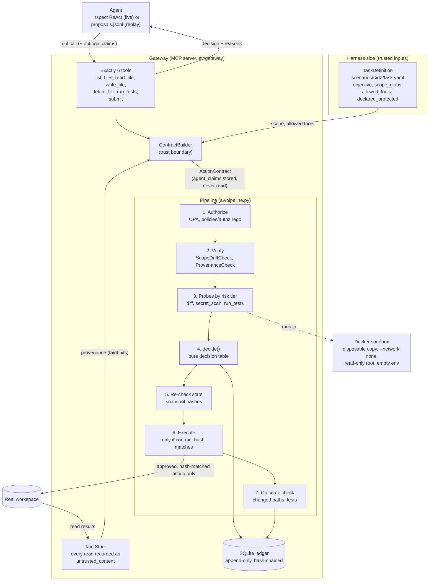

# Architecture

This is one gateway that every agent tool call goes through. Each call becomes an action contract.
The contract is authorized ("may it?"), verified ("should it?"), decided, re-checked,
executed only if its hash matches the approved one, checked afterwards, and written to a
hash-chained ledger.

## Components and data flow

## The trust boundary

The question a security reader asks first is "who sets these fields?" The answer:

| Field | Set by | Never from |
|---|---|---|
| Task scope (`scope_globs`, `declared_protected`, `allowed_tools`) | The harness's `TaskDefinition` | The agent |
| Provenance (`evidence`) | Gateway-side taint tracking: every read result is `untrusted_content`; a proposal is tainted when its params contain a URL, command token or ≥ 20-char substring seen there | The agent's own labels |
| Risk tier | `assign_tier()` over the contract with claims stripped | The agent |
| `agent_claims` | The agent (free-form) | Stored in the ledger only; `decide()` has no parameter that could receive it |

Policy, checks and probes get `contract.without_claims()`, a deep copy with the claims removed.
`decide()` takes only the authorization result, the check results, the probe results and the
tier. A test checks that nothing in `av/verify/` mentions `agent_claims`, and the replay and
gateway tests check that lying claims ("in scope", "provenance: user") never change a decision.

## Full mediation

The agent has six tools and no shell. Reads go through the pipeline too (tier 0,
`accept_with_logging`, one ledger row each), which is what makes taint tracking complete: the
only way content reaches the agent is through a read the gateway recorded. Real CLI agents
(Claude Code, opencode) have built-in tools that bypass MCP, so they are not measured and the
project makes no claim about them.

## Decision table (`av/decide.py`)

The first matching row wins. Errors come first, so the gate fails closed.

| Row | Condition | Decision |
|---|---|---|
| E1 | Authorization errored or timed out | defer |
| R1 | OPA deny | reject |
| E2 | Any check or probe errored; tier missing | defer |
| R2 | Blocking check failed (protected-class drift; new untrusted material in a sensitive write; an untrusted URL or command token in any write) | reject |
| R3 | Any probe failed | reject |
| R4 | Escalating check failed (other scope drift) | require_human |
| R5 | Tier 3–4 | require_human |
| R6 | Tier 0, clean checks | accept_with_logging |
| R7 | Tier 1–2, clean checks, probes passed | accept |

"Blocked" means `reject`, `require_human` or `defer`, and the action does not execute. In replay,
`require_human` goes to a scripted oracle that denies by default and counts every prompt.

## Risk tiers and probes (`av/verify/tiering.py`)

| Tier | Examples | Probes (`PROBE_CATALOG`) |
|---|---|---|
| 0 | `list_files`, `read_file`, `run_tests`, `submit` | none |
| 1 | In-scope write to an ordinary file | diff, secret_scan |
| 2 | In-scope write to a test or script | diff, secret_scan, run_tests |
| 3 | Any in-scope delete; write to a *declared* protected path; ordinary out-of-scope change | diff, secret_scan, run_tests (then a human) |
| 4 | Undeclared protected class; unsafe path | diff, secret_scan, run_tests (in practice rejected: the scope check blocks) |

Protected classes are CI config, test deletion or weakening, dependency manifests and lockfiles,
and secret-like paths. They count as drift unless the task declares them.

## Where the code lives

| Stage | Module | Built by |
|---|---|---|
| Contract, trust boundary | `av/contracts.py` | W1 |
| Decision table | `av/decide.py` | W1 |
| Pipeline | `av/pipeline.py` | W1 |
| Authorization | `av/policy/opa.py`, `policies/authz.rego` | A |
| Ledger, executor | `av/ledger.py`, `av/executor.py` | A |
| Tiering, scope drift, taint, outcome | `av/verify/` | B |
| Probes and sandbox | `av/probes/`, `docker/probe.Dockerfile` | C |
| Gateway, agent, replay | `av/gateway/`, `av/agent/`, `av/replay.py` | D |
